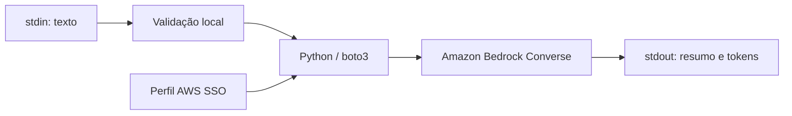

# AWS Bedrock Assistant

Demonstração técnica de **Python + IA generativa + AWS**, criada para este portfólio. Resume texto por linha de comando usando a API Converse do Amazon Bedrock. Não representa uma implantação anterior em produção.

## Testar sem conta AWS

Requer Python 3.9+. Na pasta do projeto:

```sh
python3 -m unittest discover -s tests -v
```

Os oito testes usam um cliente simulado: não acessam rede e não geram cobranças. Cobrem entrada inválida, limites de tamanho, chamada ao modelo, consumo de tokens, resposta interrompida e falhas do provedor.

## Executar com AWS

Requer conta AWS, perfil autenticado (preferencialmente SSO), região, modelo de texto compatível com Converse e permissão de invocação. Escolha o modelo e confirme disponibilidade, acesso e preços na sua conta antes de executar.

```sh
python3 -m venv .venv
. .venv/bin/activate
python -m pip install -r requirements.txt
aws sso login --profile portfolio
python assistant.py --region SUA_REGIAO --profile portfolio --model-id SEU_MODELO < texto.txt
```

Saída JSON: `summary` e `usage` com os tokens retornados pelo provedor. Sem persistência do texto ou histórico pela aplicação. Use conteúdo público ou sintético: a execução real transmite o texto ao serviço AWS.

## Arquitetura e decisões



- **Cliente injetável:** separa a lógica dos serviços AWS e permite testes offline.
- **Credenciais:** cadeia padrão do SDK, sem chaves no código ou nos argumentos.
- **Permissões:** exemplo IAM limitado a um modelo, sem `bedrock:*`. Ajuste região e ID. Perfis de inferência, especialmente entre regiões, exigem recursos e permissões adicionais; o exemplo cobre apenas o modelo direto.
- **Consumo:** entrada limitada a 12 mil caracteres/36 mil bytes, saída a 512 tokens e sem repetição automática de chamadas pelo SDK. Esses limites não constituem um teto financeiro.
- **Falhas:** timeouts definidos, saída incompleta tratada como erro, mensagens sem texto do usuário ou corpo de erro do provedor.
- **IA:** instrução de sistema separada do conteúdo, revisão humana do resumo. Isso não garante proteção contra injeção de prompt nem elimina alucinações.

## Validação e limites

Oito testes unitários passaram localmente. A integração real com Bedrock, as permissões e a compatibilidade de um modelo específico ainda precisam de validação na conta AWS. Não há infraestrutura implantada, API pública, persistência, RAG ou medição de qualidade dos resumos. Uma evolução para serviço exigirá autenticação, limites por usuário, observabilidade e avaliação com dados de referência.

## Referências

[Converse e permissões](https://docs.aws.amazon.com/bedrock/latest/userguide/conversation-inference.html) · [Referência da API](https://docs.aws.amazon.com/bedrock/latest/APIReference/API_runtime_Converse.html)
